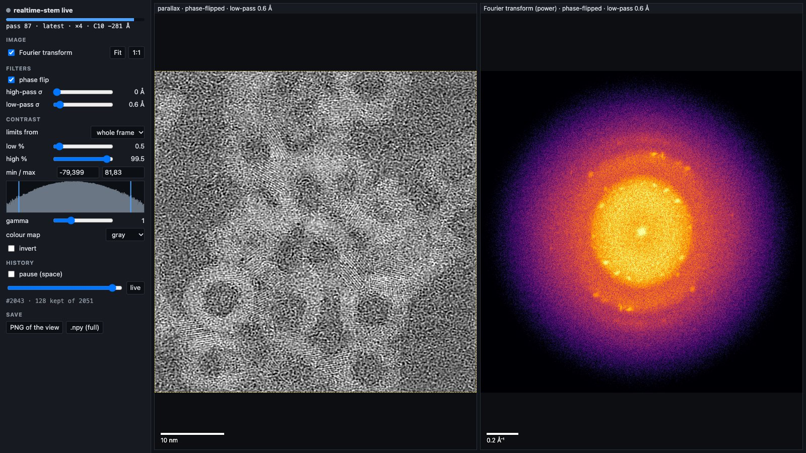

# From a recording to a live demo

How to watch the live image in a browser, measure a scan's geometry from a recording,
reconstruct it offline, replay it as a continuous acquisition, and turn the focus knob on it for
a demo. Every command works on a laptop without a detector or an NVIDIA GPU, using
`--ingest python` (Apple `mps`, or `cpu`). The worked example is the Gd₂O₃ session of
2026-10-20, in [`out_gd2o3_30mrad/`](../out_gd2o3_30mrad/README.md). Every flag is in
[CLI.md](CLI.md); the background is in [GUIDE.md](GUIDE.md).

```bash
uv venv --python 3.12 .venv && uv pip install -e ".[local,viz,replay]"   # once
```

Below, `scan.dstream` is a recording (`tools/record_stream.py`) and `scan.flags` its `run.py`
flags.

## Watch in a browser



Start the viewer, subscribed to the pipeline's live stream (`run.py --live-endpoint …`), and
open http://127.0.0.1:8050:

```bash
python -m realtime_stem.streaming.web tcp://127.0.0.1:5601
```

- **Navigation:** one panel per channel; wheel to zoom, drag to pan, double-click or `f` to fit,
  `1` for native pixels. Panels stay linked unless you untick "link".
- **Contrast:** limits from the whole frame's histogram, from what is on screen, or manual;
  gamma, colour map and invert.
- **Display filters:** high-pass and low-pass, σ in Å.
- **Fourier transform** of the visible region, with q and the d-spacing under the cursor. On a
  partly scanned image (a scan's first pass, every pass of `reset`) it uses only the finished
  rows.
- **Scale bar,** pass number and progress bar.
- **History:** pause (space) and a slider over past snapshots (`--history-mb`).
- **Export:** PNG of the views, `.npy` of the full channels.
- **URL presets:** e.g. `?channels=phase_flipped&fft=1&lp=1` for one panel with its FFT, or
  `?cmap=inferno&view=1to1`. `?snapshot` shows one snapshot without the live stream.
- **Another computer:** run the viewer next to the pipeline and `ssh -L 8050:127.0.0.1:8050
  <server>`. Only screen-sized images cross the network, so a 4096² image stays smooth.

`python examples/viewer.py tcp://127.0.0.1:5601` (matplotlib) and the notebook view still work.

## Measure the geometry of a recording

Record one scan at a known defocus, and give the acquisition values you know. The rotation
prior is the rotation you used live; it picks between C10 and the twin −C10 at θ + 180°.

```bash
python -m tools.calibrate_parallax scan.dstream --scan 256 256 --energy 200000 --semiangle 30 \
    --angular-sampling 1.066 --scan-sampling 1.9766 --rotation-prior 3.75 --out scan
```

It writes:
- `scan.flags`, the `run.py` flags: `--center`, `--flip-cols`, `--rotation`, `--defocus` and
  `--c12/--phi12`;
- `scan.json`, everything it measured;
- `scan.png`, the diagnostics.

It also reports flagged and hot pixels and whether they fall in the disk.

Departures from a quadratic aberration surface (C30, C21, C23) are reported as a diagnostic only.
Parallax corrects quadratic aberrations alone.

## Reconstruct it offline

```bash
python -m realtime_stem.apps.run --ingest python --device mps --source scan.dstream \
    $(cat scan.flags) --upsampling 4 --out-dir out/scan
```

- **Output:** `parallax_recon.npy` (the raw sum), `parallax_corrected.npy` and
  `parallax_phase_flipped.npy`.
- **Upsampling:** `--upsampling 2–8` recovers spatial frequencies past the scan's Nyquist, up to
  2α/λ.
- **Frame mean:** `--subtract-frame-mean` removes the amplitude contrast; the default keeps it.
- **DC correction:** `--no-dc-correct` turns it off. It matters mid-scan and on upsampled grids.
- **Comparing with quantem:** the Gd₂O₃ analysis does it with the same geometry
  (`out_gd2o3_30mrad/analysis/scripts/quantem_recons.py`). quantem has no column flip, so flip
  the frames first.

## Replay it live

Run the pipeline with a live stream, paced like a scan, and watch it in the browser viewer:

```bash
python -m realtime_stem.apps.run --ingest python --device mps --source scan.dstream $(cat scan.flags) \
    --upsampling 4 --source-rate 20000 --live-endpoint tcp://127.0.0.1:5601 --out-dir out/replay
```

Over ZeroMQ, as the DCU sends it, start the pipeline first:

```bash
python -m realtime_stem.apps.run --ingest python --device mps --endpoint tcp://127.0.0.1:5555 \
    $(cat scan.flags) --live-endpoint tcp://127.0.0.1:5601 --out-dir out/replay
```

then the feeder:

```bash
python -m tools.replay_to_zmq scan.dstream --endpoint tcp://127.0.0.1:5555 --rate 20000
```

## Repeated scans: loop a recording

A continuously scanning microscope sends the same area pass after pass. To get that from one
recording, loop it:

```bash
python -m tools.repeat_dstream scan.dstream loop.dstream --passes 10 --scan 256 256 --drift 1 2
```

- **The file:** one series with ids running on, as from one arm for many passes. Use
  `--series per-pass` for a series per pass, played with `--continuous`.
- **Drift:** `--drift DY DX` moves the specimen by whole scan pixels per pass.
- **The payloads** are copied byte for byte; only `image_id` changes.

```bash
python -m realtime_stem.apps.run --ingest python --device mps --source loop.dstream $(cat scan.flags) \
    --upsampling 4 --accumulate swap --source-rate 20000 --live-endpoint tcp://127.0.0.1:5601 \
    --save-passes --out-dir out/loop
```

| `--accumulate` | the live image | extra device memory |
|---|---|---|
| `latest` | the newest frame at every position: the current pass above the cursor, the previous one below | positions × bright-field pixels |
| `swap` | the current pass on the rows it has completed, the last completed pass elsewhere; with `--pass-average β`, a running average of passes | one image |
| `reset` | the current pass alone, filling in | one image |
| `all` | every frame of every pass | — |

- **Saving passes:** `--save-passes` writes each completed pass to `out/loop/passes/`, a movie of
  the session.
- **Comparing the modes:** `scripts/compare_accumulate.py loop.dstream $(cat scan.flags)
  --out cmp.png` shows each mode's live image part-way through each pass, against the true pass
  images.
- To keep a loop running, replay it to `run.py --continuous` in a loop:
  `while true; do python -m tools.replay_to_zmq loop.dstream --endpoint … --rate 20000; done`.

## A focus-walk demo

The microscope's focus can be turned on a recording too. Under the parallax model, a defocus
change only moves each bright-field pixel's image by ΔC10·α along its tilt. So each pass is
rewritten as the scan would look at another defocus. Reconstructing with the recording's own
flags, the image sharpens as the "knob" reaches focus:

```bash
python -m tools.refocus_dstream scan.dstream walk.dstream --flags scan.flags \
    --defocus-schedule -500 -450 -400 -350 -300 -316 -316 -316
```

The schedule above walks the Gd₂O₃ binned scan, recorded at −316 Å, from −500 Å into focus. A
pass written at −500 Å measures −501 Å with `tools.calibrate_parallax`. The moves are whole scan
pixels, so steps smaller than about one pixel at the disk edge don't show.

For the demo, start the viewer, then the pipeline (`--continuous`), then the looping feeder, each
in its own terminal:

```bash
python -m realtime_stem.streaming.web tcp://127.0.0.1:5601        # http://127.0.0.1:8050
```

```bash
python -m realtime_stem.apps.run --ingest python --device mps --endpoint tcp://127.0.0.1:5555 \
    $(cat scan.flags) --upsampling 4 --accumulate latest --continuous \
    --live-endpoint tcp://127.0.0.1:5601 --out-dir out/demo
```

```bash
while true; do python -m tools.replay_to_zmq walk.dstream --endpoint tcp://127.0.0.1:5555 --rate 15000; done
```

At 15 kHz each pass of 65,536 frames takes about 4 s. `?channels=phase_flipped` gives one large
panel for recording.
